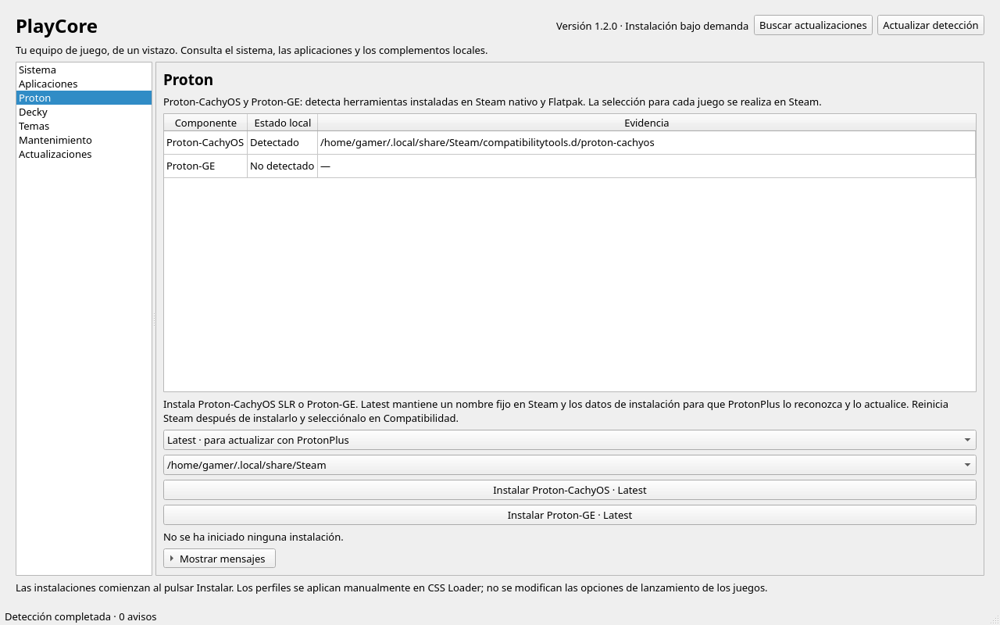
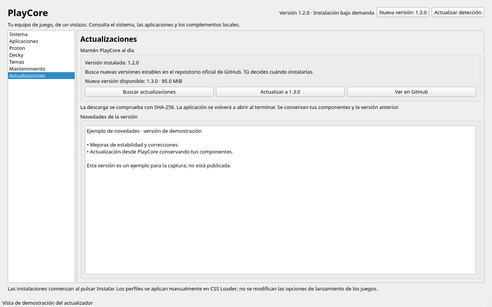
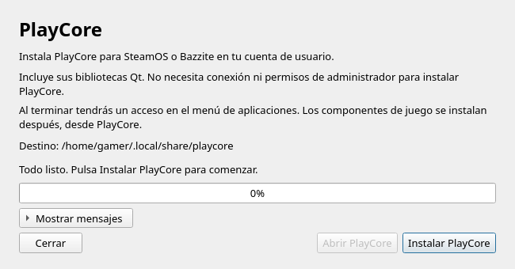
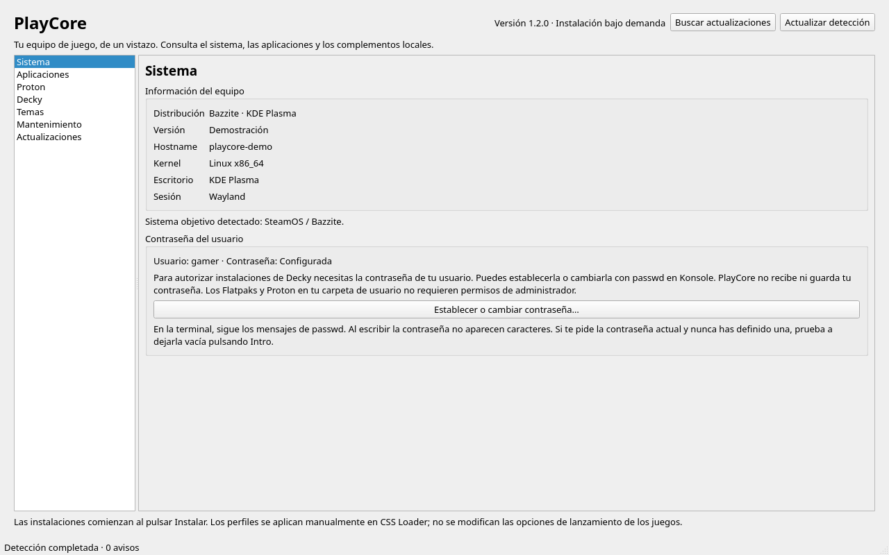
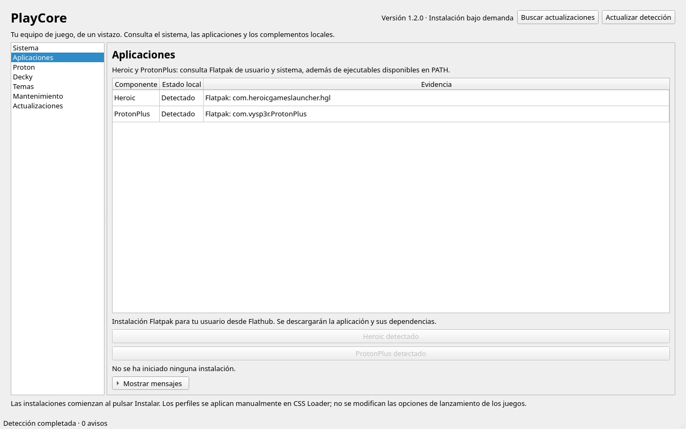
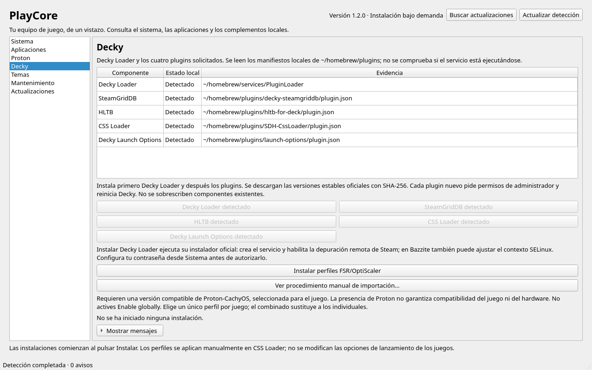
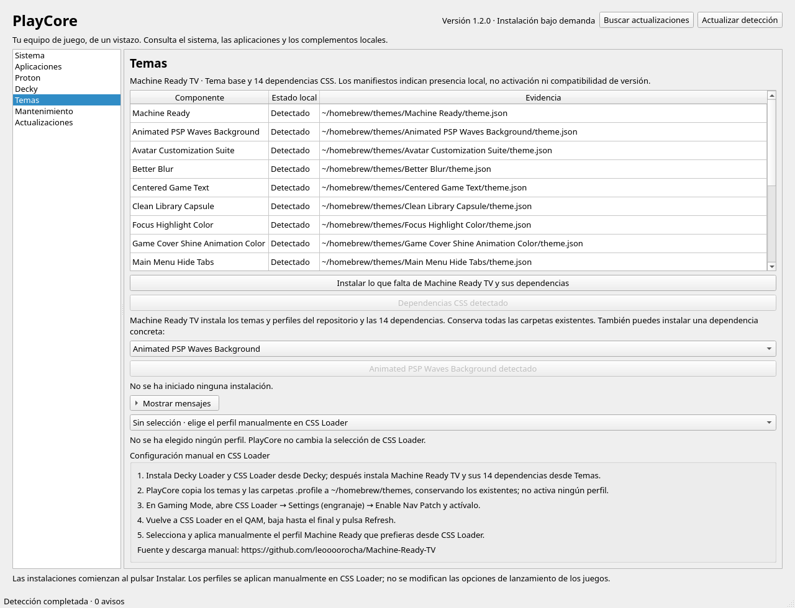
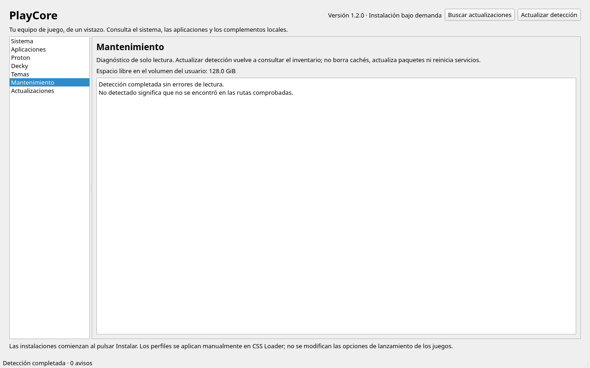
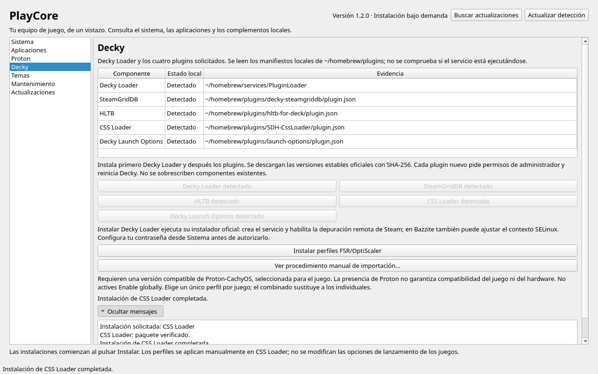

# PlayCore 1.2

**Español** · [English](#english) · [Documentación técnica / Technical documentation](docs/README.es.md)

Panel de escritorio en Python y PySide6 para **SteamOS y Bazzite con KDE Plasma**.
Detecta el sistema y los componentes instalados y permite instalar herramientas de juego
desde una interfaz gráfica. La interfaz de la aplicación está en español.



*Interfaz real con datos de demostración. / Real interface with demonstration data.*

[Ver capturas / View screenshots](#screenshots) · [Descargar / Download](https://github.com/pettersdark/PlayCore/releases/tag/v1.2.0)

## Español

### Actualizaciones desde la aplicación (1.2.0)

PlayCore consulta las versiones estables de GitHub al abrirse. En **Actualizaciones**
puedes buscar de nuevo, leer las novedades y pulsar **Actualizar a…**. Tras confirmar,
descarga el instalador oficial, comprueba el SHA-256, instala la nueva versión y la abre.
La ventana anterior se cierra después de abrir la nueva; si falla, puedes seguir usándola.
Se conservan los componentes y las versiones anteriores de PlayCore.

Quienes tengan 1.0.0 o 1.1.0 deben instalar 1.2.0 manualmente una vez. La actualización desde
la app requiere una copia instalada con el instalador; las copias del código fuente
pueden consultar las novedades. Desde 1.2.0 podrás instalar
1.3.0 y posteriores desde la aplicación cuando se publiquen.



Para publicar futuras actualizaciones, crea una release estable con una etiqueta como
`v1.3.0` y adjunta `PlayCore-1.3.0-Bazzite-x86_64.run` y su `.run.sha256`.
Las notas de esa release aparecerán en la aplicación. El constructor toma la versión
de `playcore/__init__.py`; mantenla sincronizada con `pyproject.toml`.

### Descargar e instalar, sin terminal

1. Abre [la Release 1.2.0](https://github.com/pettersdark/PlayCore/releases/tag/v1.2.0).
2. Descarga [PlayCore-1.2.0-Bazzite-x86_64.run](https://github.com/pettersdark/PlayCore/releases/download/v1.2.0/PlayCore-1.2.0-Bazzite-x86_64.run).
3. Haz doble clic en el fichero. Si Dolphin lo pregunta, elige **Ejecutar**.
4. Si el navegador ha quitado el permiso de ejecución: botón derecho → **Propiedades → Permisos → Es ejecutable**. Vuelve a abrirlo.
5. Pulsa **Instalar PlayCore** y, al terminar, **Abrir PlayCore**. También aparecerá en el menú de aplicaciones.



*Así se abre el instalador antes de pulsar Instalar PlayCore. La ruta mostrada es de demostración.*

No uses sudo ni necesitas abrir una terminal. El instalador incluye sus dependencias
Qt y funciona sin conexión; instalar componentes desde la aplicación sí requiere Internet.
El escritorio puede pedir que confirmes que confías en el fichero descargado.

**Requisitos del instalador:** Linux x86_64, KDE Plasma, Python 3.11+ con venv y los
filtros seguros de tarfile, glibc 2.34+ y alrededor de 1 GB libre. No incluye Python.
Este fichero no sirve para Windows ni ARM. Breeze depende de la integración Qt disponible.

### Qué incluye

| Sección | Funciones |
| --- | --- |
| Sistema | Detección de SteamOS/Bazzite, hostname y estado de la contraseña del usuario |
| Aplicaciones | Heroic y ProtonPlus desde Flathub |
| Proton | Detección e instalación de Proton-CachyOS y Proton-GE para el Steam elegido |
| Decky | Decky Loader, SteamGridDB, HLTB, CSS Loader y Decky Launch Options |
| Temas | Machine Ready TV, sus perfiles y las 14 dependencias CSS |
| Mantenimiento | Espacio libre y avisos de detección |
| Actualizaciones | Versiones estables, novedades, descarga verificada e instalación de PlayCore |

Cada instalación comienza al pulsar su botón. El resumen final permanece visible;
el registro se abre y cierra con **Mostrar mensajes / Ocultar mensajes**.
Las carpetas existentes se conservan. PlayCore no instala ProtonUp-Qt, PortProton ni Ludusavi.

### Contraseña y permisos

En **Sistema → Establecer o cambiar contraseña…** se abre Konsole con la herramienta
`passwd` para tu usuario. Introduce la contraseña allí, siguiendo sus mensajes; al escribir
no aparecen caracteres. Cierra Konsole al terminar para actualizar el estado en PlayCore.
PlayCore no recibe ni guarda la contraseña. Este diálogo de cuenta utiliza una terminal;
el instalador gráfico de PlayCore no requiere abrirla.

Decky y sus plugins piden autorización de administrador mediante PolicyKit. El instalador
oficial de Decky crea un servicio, habilita la depuración remota de Steam y puede ajustar
SELinux en Bazzite. Los Flatpaks, Proton y los temas de usuario no necesitan permisos
administrativos si sus carpetas tienen los permisos habituales.

### Machine Ready TV: elegir el perfil manualmente

1. Instala **Decky Loader** y **CSS Loader** desde Decky.
2. En Temas, instala lo que falte de **Machine Ready TV y sus dependencias**.
3. En Gaming Mode: CSS Loader → Settings → activa **Enable Nav Patch**.
4. Vuelve a CSS Loader en el QAM, baja hasta el final y pulsa **Refresh**.
5. Selecciona y aplica **manualmente** el perfil deseado en CSS Loader.

PlayCore copia temas y perfiles sin activar ninguno. Tras instalar Proton, reinicia
Steam y elige la herramienta manualmente en las opciones de compatibilidad.

### Ubicación y ayuda

Instala en `~/.local/share/playcore/versions`, con accesos en `~/.local/bin/playcore`
y `~/.local/share/applications/playcore.desktop`. Puedes borrar el instalador al terminar.
Si algo falla, abre **Mostrar mensajes** y adjunta el error a una
[incidencia](https://github.com/pettersdark/PlayCore/issues), indicando distribución y sección.
No incluyas contraseñas ni tokens. «Detectado» indica presencia, no compatibilidad
garantizada con tu versión de Steam. El instalador ha sido probado por el usuario;
el catálogo completo no se ha verificado en todos los dispositivos.

## English

### In-app updates (1.2.0)

PlayCore checks stable GitHub releases on startup. Open **Actualizaciones** to check
again, read release notes and confirm an update. It verifies the official installer's
size and SHA-256, installs it and reopens PlayCore, preserving existing components
and previous app versions. Failed updates leave the current app available.
Users on 1.0.0 or 1.1.0 must install 1.2.0 manually once. Source checkouts can check releases;
in-app installation requires a copy installed with the graphical installer.
Future releases, including 1.3.0, can then be installed from the app when published.

PlayCore is a **Python/PySide6 desktop application for SteamOS and Bazzite with KDE Plasma**.
It detects your system and installed components and provides explicit installation actions.
The application UI is currently in Spanish; installation and usage instructions are provided here in both languages.

### Download and install without a terminal

1. Open [Release 1.2.0](https://github.com/pettersdark/PlayCore/releases/tag/v1.2.0).
2. Download [PlayCore-1.2.0-Bazzite-x86_64.run](https://github.com/pettersdark/PlayCore/releases/download/v1.2.0/PlayCore-1.2.0-Bazzite-x86_64.run).
3. Double-click the file and choose **Execute** if Dolphin asks.
4. If the download lost its executable permission: right-click → **Properties → Permissions → Is executable**, then open it again.
5. Click **Instalar PlayCore** (Install PlayCore), then **Abrir PlayCore** (Open PlayCore). A launcher is also added to your application menu.


*The installer before clicking Install PlayCore. The displayed destination uses demonstration data.*

Do not use sudo. You do not need to open a terminal. Qt dependencies are bundled,
so installing PlayCore works offline; installing gaming components from the app requires Internet.
Your desktop may ask you to trust or allow the downloaded executable.

**Installer requirements:** Linux x86_64, KDE Plasma, Python 3.11+ with venv and safe
tarfile extraction filters, glibc 2.34+, and about 1 GB free. Python itself is not bundled.
This installer does not support Windows or ARM. Breeze styling depends on the available Qt integration.

### Features

| Section | Features |
| --- | --- |
| Sistema / System | SteamOS/Bazzite detection, hostname and account password status |
| Aplicaciones / Applications | Heroic and ProtonPlus from Flathub |
| Proton | Detect and install Proton-CachyOS and Proton-GE for the selected Steam installation |
| Decky | Decky Loader, SteamGridDB, HLTB, CSS Loader and Decky Launch Options |
| Temas / Themes | Machine Ready TV, profiles and its 14 CSS dependencies |
| Mantenimiento / Maintenance | Free space and detection warnings |

Installations only start when you click their buttons. Completion messages remain visible;
use **Mostrar mensajes / Ocultar mensajes** to show or hide the small log panel.
Existing folders are preserved. ProtonUp-Qt, PortProton and Ludusavi are excluded.

### Passwords and administrator permissions

**Sistema → Establecer o cambiar contraseña…** opens Konsole running `passwd` for
your current user. Follow its prompts; typed passwords are hidden. Close Konsole when
finished so PlayCore can refresh the account status. PlayCore does not receive or store
your password. This account action uses a terminal; the PlayCore graphical installer does not require one.

Decky and its plugins request administrator approval through PolicyKit. The official
Decky installer creates a service, enables Steam remote debugging and may adjust SELinux
on Bazzite. User Flatpaks, Proton and themes do not require administrator permissions
when their destination folders have normal user permissions.

### Machine Ready TV: manual profile selection

1. Install **Decky Loader** and **CSS Loader** from the Decky section.
2. From Temas, install missing **Machine Ready TV themes and dependencies**.
3. In Gaming Mode: CSS Loader → Settings → turn on **Enable Nav Patch**.
4. Return to CSS Loader in the QAM, scroll to the bottom and click **Refresh**.
5. **Manually select and apply** your preferred profile in CSS Loader.

PlayCore copies themes and profiles without activating them. After installing Proton,
restart Steam and manually select the compatibility tool for your game.

### Installation location and troubleshooting

Files are installed under `~/.local/share/playcore/versions`, with launchers at
`~/.local/bin/playcore` and `~/.local/share/applications/playcore.desktop`.
You can delete the downloaded installer afterwards. For errors, expand **Mostrar mensajes**
and include the error, distribution and affected section in an
[issue](https://github.com/pettersdark/PlayCore/issues). Do not include passwords or tokens.
“Detected” means present, not guaranteed compatible with your Steam version.
The user has tested the installer; every catalog component has not been validated on every device.

<a id="screenshots"></a>

## Capturas / Screenshots

Capturas de los widgets reales de PlayCore 1.2 con datos de demostración, sin datos
personales ni instalaciones reales. El aspecto puede variar según la integración Qt de KDE.

Screenshots of the actual PlayCore 1.2 widgets using demonstration data, without personal
information or live installations. Appearance may vary with your KDE/Qt integration.

<details>
<summary>Ver todas las secciones / View all sections</summary>

| Sistema / System | Aplicaciones / Applications |
| --- | --- |
| [](docs/images/v1.2/sistema.png) | [](docs/images/v1.2/aplicaciones.png) |

| Proton | Decky |
| --- | --- |
| [](docs/images/v1.2/proton.png) | [](docs/images/v1.2/decky.png) |

| Temas / Themes | Mantenimiento / Maintenance |
| --- | --- |
| [](docs/images/v1.2/temas.png) | [](docs/images/v1.2/mantenimiento.png) |

**Mensajes desplegables / Collapsible messages**



</details>

## Development / Desarrollo

**Perfiles FSR/OptiScaler:** en Decky, pulsa **Instalar perfiles FSR/OptiScaler** para
enviar los tres perfiles a Steam con IDs estables y sin activación global. Solo
debes revisar y confirmar en Decky; requiere la conexión local de Steam disponible y
Proton-CachyOS compatible. [Procedimiento y verificación en Manage Launch Options](docs/DECKY_LAUNCH_OPTIONS.md).

**FSR/OptiScaler profiles:** the Decky action sends three profiles with stable IDs
and global enablement disabled directly to Steam. Review and confirm in Decky.
Steam's local debugging connection and compatible Proton-CachyOS are required. The profiles
share an exclusive dropdown. [Import and verification guide (Spanish)](docs/DECKY_LAUNCH_OPTIONS.md).

```bash
git clone https://github.com/pettersdark/PlayCore.git
cd PlayCore
python3 -m venv .venv
.venv/bin/python -m pip install 'PySide6>=6.8,<7'
.venv/bin/python -m playcore
QT_QPA_PLATFORM=offscreen .venv/bin/python -m unittest discover -v
```

68 automated tests cover detection, installers, archive validation, password handling,
manual profiles, persistent completion status, collapsible messages and packaging.
Tests use temporary folders and mock privileged actions; they do not install gaming components or change passwords.

[Documentación técnica en español](docs/README.es.md) · [Release notes / Notas](RELEASE_NOTES.md) ·
[Third-party components / Componentes de terceros](THIRD_PARTY.md)

Para regenerar las capturas con datos de demostración / To regenerate screenshots with demonstration data:

```bash
QT_QPA_PLATFORM=offscreen .venv/bin/python scripts/capture_screenshots.py
```
