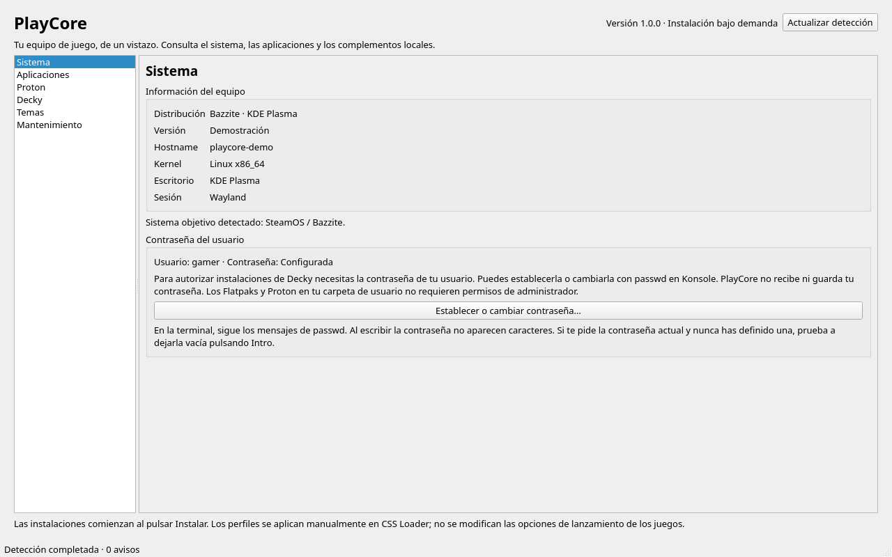

# PlayCore 1.0



[Ver todas las capturas](../README.md#screenshots). Son capturas de la interfaz real
con datos de demostración; no muestran información personal ni instalaciones reales.

Panel de escritorio en Python y PySide6 para SteamOS y Bazzite, con inventario local,
instalación explícita y acceso al cambio de contraseña del usuario.
No se instala nada al abrir la aplicación.

La versión 1.0 añade Proton-GE, un resumen persistente de instalación completada,
mensajes pequeños y plegables, y un instalador gráfico offline de un solo fichero.
El usuario ha probado el instalador 1.0 y ha autorizado su publicación pública en pettersdark/PlayCore.

## Abrir

Desde Konsole en KDE Plasma:

```bash
cd ~/Proyectos/PlayCore
.venv/bin/python -m playcore
```

Para abrir directamente una sección: `.venv/bin/python -m playcore --section Decky`.
Se necesita Python 3.11 o posterior, con una revisión que incluya los filtros de
extracción de tarfile para instalar Proton. El entorno `.venv` ya contiene PySide6.
Para preparar una copia nueva:

```bash
python3 -m venv .venv
.venv/bin/python -m pip install 'PySide6>=6.8,<7'
```

Qt Widgets respeta el estilo, iconos, paleta y tipografía del escritorio. Breeze
depende de que Python/Qt disponga de un plugin Plasma compatible; las ruedas de
PySide6 pueden recurrir al estilo de respaldo de Qt.

## Contraseña del usuario

En **Sistema → Establecer o cambiar contraseña…**, PlayCore abre Konsole con
`passwd`, como el usuario actual. Introduce allí la contraseña actual si se solicita
y la nueva dos veces. Si nunca has definido una y se pregunta por la actual, prueba
a pulsar Intro sin escribir nada. Los caracteres no se muestran al escribir.

La terminal conserva el resultado hasta que la cierres. Después PlayCore relee el
estado público con `passwd -S`: configurada, sin contraseña, bloqueada o desconocido.
PlayCore no solicita, captura, transmite ni guarda la contraseña. Una cuenta bloqueada
o una contraseña actual olvidada pueden requerir recuperación administrativa fuera
de esta función. El cambio solo se ejecuta cuando lo completas en la terminal.

Los permisos administrativos para Decky se autorizan en el diálogo de PolicyKit.
Los Flatpaks, temas de usuario y Proton no necesitan contraseña de administrador
si sus carpetas tienen los permisos habituales.

## Instaladores

| Sección | Componentes y destino |
| --- | --- |
| Aplicaciones | Heroic y ProtonPlus, Flatpak de Flathub para el usuario |
| Proton | Proton-CachyOS SLR y Proton-GE estables, en el Steam nativo o Flatpak elegido |
| Decky | Decky Loader, SteamGridDB, HLTB, CSS Loader y Decky Launch Options |
| Temas | Machine Ready TV, temas personalizados y perfiles, más 14 dependencias CSS |
| Sistema | Estado de la cuenta y acceso a establecer/cambiar contraseña |
| Mantenimiento | Espacio libre y avisos, sin limpiezas ni actualizaciones del sistema |

**Decky Loader:** descarga `install_release.sh` de la publicación estable del
instalador oficial, valida SHA-256 y lo ejecuta mediante PolicyKit. Ese instalador
crea el servicio del sistema, habilita la depuración remota de Steam y puede ajustar
SELinux en Bazzite. No se ejecuta si ya existe PluginLoader. Necesita las herramientas
del instalador oficial, como curl, jq, sudo y systemd; muestra sus errores en el registro.

**Plugins Decky:** usa el catálogo estable de Deckbrew para SteamGridDB, HLTB y
CSS Loader; Launch Options usa la publicación estable del autor en GitHub.
Comprueba SHA-256, identidad y estructura antes de pedir permisos y de nuevo en el
ayudante. Instala el plugin solicitado y reinicia `plugin_loader.service`. Requiere
Decky en `~/homebrew`, `pkexec` y `/usr/bin/python3`. HLTB se admite sin backend Python.
No admite plugins con permisos root o descargas adicionales de binarios.

**Proton-CachyOS y Proton-GE:** selecciona CachyOS SLR para x86_64 base o arm64,
sin elegir x86_64_v3 automáticamente, o la publicación oficial GE para x86_64/aarch64.
Admite también las publicaciones anteriores de GE sin sufijo de arquitectura en x86_64.
Descarga por bloques a disco y valida SHA-256 antes de extraer.
Requiere espacio para la descarga y 5 GiB de margen. Elige Steam de destino si hay
varias instalaciones. Reinicia Steam y selecciona la herramienta manualmente en
Compatibilidad. No cambia opciones de lanzamiento ni reemplaza versiones instaladas.

**Temas:** copia solo carpetas nuevas; no mezcla ni reemplaza las existentes.
Machine Ready TV se obtiene desde una revisión fija del repositorio, identificada
por la API de GitHub. Copia temas y perfiles sin ejecutar scripts del repositorio.
Las dependencias proceden de DeckThemes mediante sus IDs y requieren temas aprobados.
Estos ZIP no publican SHA-256 en la API: se usa HTTPS con verificación TLS, validación
de identidad y comprobación de rutas. Puedes instalar las 14 o una dependencia concreta.

Las instalaciones requieren conexión, muestran progreso/resultado y actualizan el
inventario. Al terminar conservan el resumen **Instalación de [componente] completada**;
la actualización del inventario no lo sustituye. Un error conserva su resumen de fallo.
El registro detallado está oculto inicialmente y se abre/cierra con **Mostrar mensajes /
Ocultar mensajes**, con una altura reducida de 90 píxeles. El resumen permanece visible.
Los botones de elementos detectados se deshabilitan. El botón de Machine
Ready TV permite completar carpetas y perfiles ausentes. Una operación compuesta
puede quedar parcialmente completada si falla la red o el disco; vuelve a ejecutarla
para completar lo que falta. Si falla el reinicio de Decky después de copiar un plugin,
el registro lo indica. No se cambia la raíz inmutable mediante gestores de paquetes,
ni se añaden ProtonUp-Qt, PortProton o Ludusavi.

## Machine Ready TV: activación manual

Instala primero Decky Loader y CSS Loader. Después instala Machine Ready TV desde
Temas. Se conservan las carpetas existentes en `~/homebrew/themes`. Las dependencias:

1. Animated PSP Waves Background
2. Avatar Customization Suite
3. Better Blur
4. Centered Game Text
5. Clean Library Capsule
6. Focus Highlight Color
7. Game Cover Shine Animation Color
8. Main Menu Hide Tabs
9. No Friend Playing Icon
10. No Hero Gradient
11. No Home Tabs
12. QAM Hide Tabs
13. Top Bar Padding
14. Volume Tweaker

Reconoce también los nombres de tienda `Main Menu Hide Tabs (hide the Store)` y
`no_home_tabs`. Para activar tu perfil en Gaming Mode:

1. CSS Loader → Settings → **Enable Nav Patch**: actívalo.
2. Vuelve a CSS Loader en el QAM, baja hasta el final y pulsa **Refresh**.
3. Selecciona y aplica **manualmente** el perfil Machine Ready que prefieras.

El selector de perfiles de PlayCore es de consulta y no aplica ninguno.

## Detección y estructura

El inventario lee `os-release`, hostname, despliegues Flatpak de usuario/sistema,
ejecutables en PATH y manifiestos de Decky y temas. Respeta `XDG_DATA_HOME` y las
rutas habituales de Steam nativo y Flatpak. Los datos residuales de `~/.var/app`
no cuentan por sí solos como instalación de Heroic o ProtonPlus. Las consultas
`flatpak list` y `passwd -S` tienen un límite de cinco segundos. La detección y
los instaladores se ejecutan fuera del hilo de la interfaz.

«Detectado» indica presencia, no servicio activo ni compatibilidad validada con Steam.
No se buscan rutas personalizadas o AppImages fuera de PATH por todo el disco.
Los errores aparecen en Mantenimiento. No hay telemetría ni instalaciones al detectar.

```text
playcore/
  __main__.py         Entrada y sección inicial
  catalog.py          Aplicaciones, plugins, temas, IDs y guía
  models.py           Resultados de inventario
  system.py           Distribución, hostname, kernel y escritorio
  accounts.py         Estado público y comando interactivo de contraseña
  detection.py        Inventario de solo lectura
  installers.py       Descargas e instalaciones solicitadas
  plugin_package.py   Validación y despliegue de plugins
  content_packages.py Extracción controlada de temas y Proton
  install_helper.py   Ayudante de PolicyKit para Decky y plugins
  ui.py               Secciones y trabajos en segundo plano
tests/                Detección, instalación, cuenta y Qt
```

## Pruebas

```bash
QT_QPA_PLATFORM=offscreen .venv/bin/python -m unittest discover -v
```

**68 pruebas automatizadas** con carpetas temporales, red y permisos simulados.
Cubren SteamOS/Bazzite, cuenta sin secretos, selección de Steam, descarga por bloques
y SHA-256, plugins sin backend, rutas maliciosas, enlaces de Proton, conservación
de carpetas, perfiles manuales, Proton-GE, mensajes plegables, persistencia de éxito/error
y el instalador gráfico sin operaciones antes del clic. La acción de contraseña
de la UI se prueba con un proceso inocuo, sin ejecutar passwd.

Se validaron y extrajeron en carpetas temporales los ZIP oficiales de los tres plugins
nuevos, las 14 dependencias CSS y Machine Ready TV (36 carpetas, incluidos 18 perfiles
en la revisión consultada). No se instalaron componentes ni se cambió la contraseña
del equipo durante esta ampliación. Proton se prueba con archivos simulados y metadatos
reales, sin descargar su distribución completa. Queda pendiente validar los nuevos
instaladores con permisos reales y en hardware Bazzite. Launch Options de la versión
anterior fue probado por el usuario.

## Paquete para probar en otro equipo

El fichero principal es `entrega/PlayCore-1.0.0-Bazzite-x86_64.run`. Cópialo a Bazzite
y ábrelo con doble clic: se abre un asistente con **Instalar PlayCore** y, al terminar,
**Abrir PlayCore**. No hay que abrir una terminal ni escribir comandos. Si el navegador
o el USB elimina el permiso de ejecución, actívalo gráficamente en **Propiedades →
Permisos → Es ejecutable**. Dolphin puede pedir que confirmes la ejecución de un fichero
descargado; esa confirmación pertenece al escritorio.

El `.run` comprueba SHA-256, extrae una copia temporal y arranca Qt desde los wheels
incluidos. Antes del clic solo escribe archivos temporales: no instala PlayCore ni
crea accesos. Al pulsar Instalar, el asistente ejecuta la instalación offline en
segundo plano y muestra su resultado. No usa sudo. La carpeta y el `.tar.gz` se
conservan como formatos auxiliares; el `.run` es la descarga para el usuario final.
Necesita Python 3.11+ con venv y filtros de tarfile, Linux x86_64, glibc 2.34+ y alrededor
de 1 GB libre para temporales e instalación. No incluye un intérprete Python.

Instala en `~/.local/share/playcore/versions`, crea `~/.local/bin/playcore` y un acceso
en el menú de aplicaciones. Puedes borrar la carpeta del instalador después.
Las descargas de aplicaciones y complementos desde PlayCore siguen necesitando red.
`LEEME.txt` contiene los pasos y las limitaciones de la prueba en Bazzite.

Para reconstruir el paquete con los tres wheels ya descargados:

```bash
python3 scripts/build_release.py --wheel-dir /ruta/a/los/wheels --output /ruta/de/entrega
```

El paquete previo 0.3 funcionó en Bazzite según la prueba del usuario. El instalador
1.0 también ha sido probado satisfactoriamente por el usuario. Las pruebas locales se hacen
en carpetas temporales, sin instalar componentes de juego ni cambiar contraseñas.

## Distribución en GitHub

El repositorio de destino es [pettersdark/PlayCore](https://github.com/pettersdark/PlayCore).
La descarga para el usuario final es el fichero `.run` de la [Release 1.0.0](https://github.com/pettersdark/PlayCore/releases/tag/v1.0.0).
Consulta [las instrucciones en ambos idiomas](../README.md) y [el procedimiento de publicación](PUBLICAR_GITHUB.md).

## Fuentes del catálogo

- [Decky Loader](https://github.com/SteamDeckHomebrew/decky-loader) e [instalador](https://github.com/SteamDeckHomebrew/decky-installer)
- [Tienda Decky](https://plugins.deckbrew.xyz/plugins)
- [Decky Launch Options](https://github.com/Wurielle/decky-launch-options)
- [CSS Loader](https://github.com/DeckThemes/SDH-CssLoader) y [DeckThemes](https://api.deckthemes.com)
- [Machine Ready TV](https://github.com/leoooorocha/Machine-Ready-TV)
- [Proton-CachyOS](https://github.com/CachyOS/proton-cachyos)
- [Proton-GE](https://github.com/GloriousEggroll/proton-ge-custom)
- [Opciones de Konsole](https://docs.kde.org/stable_kf6/es/konsole/konsole/command-line-options.html)
